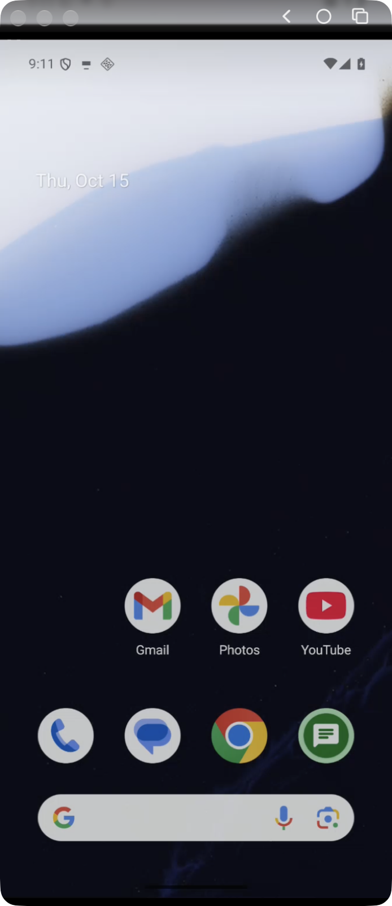
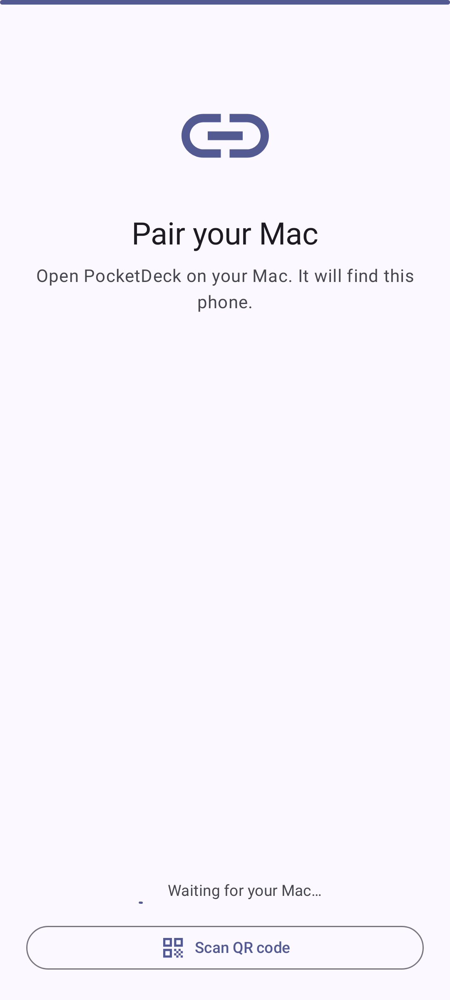

# Contigua

Contigua runs Android apps in native Mac windows over your home network, with
the phone staying locked.

<!-- demo video goes here -->

| Two apps in Mac windows (Clock in Immersive style, Settings in Framed style — both are the actual Android app) | The Deck: the phone's app grid on the Mac |
|---|---|
|  |  |

| The phone window mirrors the phone's own screen (Back / Home / Recents at the right of the bar) | Pairing, step by step on the phone |
|---|---|
|  |  |

> **Status: pre-release alpha. There are no binaries yet; build from source.**
> The recipe in [docs/TRY-IT.md](docs/TRY-IT.md) needs no Apple Developer ID:
> `macos/scripts/bundle.sh` signs the app and its Share, File Provider and
> Control Center extensions ad-hoc (`codesign --sign -`). From such a build the
> windows, input, audio, clipboard, links, share, drops, APK install, MCP and
> the Finder location work; the Share and Finder extensions need a one-time
> switch in System Settings › General › Login Items & Extensions
> ([docs/design/files.md](docs/design/files.md)). The Control Center controls
> do not appear yet (see Features below), and phone-as-camera needs a
> Developer ID and is not in the main branch.

Contigua runs a tiny server inside [Shizuku](https://shizuku.rikka.app/)'s
shell process on the phone, with one virtual display per app window, and
streams video over a single TCP session to the Mac. The Mac draws each stream
in a real window with `AVSampleBufferDisplayLayer` and sends real touch,
keyboard and scroll back, so you can resize a window into any shape and the
app re-lays out to it. Audio comes from the phone to the Mac. No cables, no
cloud.

## Features

Everything in the first group is part of the source-build recipe. Several
features are marked in [docs/ROADMAP.md](docs/ROADMAP.md) as built but still
waiting for a hands-on check on a real Mac and phone.

### Works from a source build

**Windows and input**

- **One window per app** — pick any app in the Deck (⌘K to search) and it opens
  in its own resizable Mac window; resize into any shape and the app re-lays
  out. Several app windows at once.
- **Phone window** — a mirror of the phone's own screen (status bar, lock
  screen, home, apps), turning with the phone, with Back/Home/Recents buttons.
- **Real input** — typed keys, clicks, drags and scroll; right-click is Android
  Back, middle-click is Home, and a mouse's side **Back** button sends Back. On
  a trackpad, two-finger scroll drags the page like a finger (with fling) and
  pinch/rotate are two fingers around the pointer.
- **Window styles** — a Framed bar (always visible, holds the traffic lights)
  or Immersive (the window *is* the app; a dwell pill brings the lights back).
  Switch with View ▸ Window Style or ⌥⌘F; the choice is remembered per app.
- **Open <App> on Mac (handoff)** — move the task in the phone's foreground onto
  the Mac (the card's row, the Phone menu, or ⌘⇧C): same app, a new window.
- **Live Text** — View ▸ Live Text (⌘⇧T) freezes a window on its current frame:
  select and copy text, use data detectors, lift an image subject, Visual Look
  Up, translate where macOS offers it. ⌘C without a selection copies the
  whole frame. Input stays paused while the mode is
  on; Esc brings live video back ([docs/design/livetext.md](docs/design/livetext.md)).

**Audio**

- **Audio from the phone to the Mac** — with a window open, the phone's media
  and game audio plays on the Mac with a volume slider and mute in the menu
  bar; media stays silent on the phone's speaker. Capture follows the focused
  window's app where Android allows it and falls back to all-device audio.
  Added latency measured around 80–125 ms on the API 36 emulator
  ([docs/design/audio.md](docs/design/audio.md)).

**Clipboard, links, share, drag and drop, APK install, files**

- **Clipboard text, both ways** — copy on the phone, paste on the Mac and the
  other way round; clipboard **images** travel both ways too.
- **Links Mac → phone** — Share → **Open on Phone**, Services, or drop a link
  on the Deck; it opens in the Android app that handles it, in a new window.
- **Share phone → Mac** — Android Share → **Send to Mac**: links open in the
  Mac's browser, text lands on the Mac clipboard, images up to 50 MB each are
  saved to `~/Downloads/Contigua/` (and the clipboard).
- **Drag and drop** — drop files from Finder on any phone window; the phone
  writes them to `Downloads/Contigua/`, scans them and offers the app's Send
  chooser. Up to 200 MiB per file, resumable.
- **Install APKs from the Mac** — drop an `.apk` / `.apks` / `.xapk` bundle on
  the Deck, or use Open With, Services or the menu bar. The Deck shows
  progress and the result.
- **Focus sync** — a Mac Focus with the Contigua filter turns the phone's Do
  Not Disturb on (priority, alarms only or nothing) and back when it ends. A DND
  you set yourself is never turned off. The menu bar toggles the phone's DND by
  hand, and a Shortcut can too.
- **Phone files in Finder** — the phone's shared storage appears as a
  **Contigua** location in Finder: browse, Quick Look, copy out, and copy in,
  edit, rename, move, make folders and delete. A delete is immediate (the phone
  has no Trash), and a copy onto an existing name is refused, never silently
  replaced. Cached files stay readable while the phone is away. Turn Contigua
  on once in System Settings › General › Login Items & Extensions. Conflict
  handling, watching and verification: [docs/design/files.md](docs/design/files.md).

**The Mac knows the phone**

- **Dock and Launchpad apps** — right-click an app in the Deck → **Add to
  Dock**: a real Mac app bundle named "App (Phone)" with the app's icon, in
  Launchpad, Spotlight and ⌘-Tab. Launching it opens that app's window.
- **Spotlight** — every phone app searches as "App (Phone name)".
- Silently reconnects to the last phone; closes a window by closing the app's
  display, saves bandwidth when a window is hidden or covered, and asks the
  phone for nothing while you're not looking (battery rules in
  docs/ARCHITECTURE.md).

**Security**

- One LAN-only TCP session per phone, one Bonjour advertisement
  (`_contigua._tcp`), and direct connect by address. Pairing shows a
  six-digit code on both screens (numeric comparison) or exchanges a QR code;
  sessions are authenticated with keys created at pairing (docs/PROTOCOL.md).

### Built but unproven on real hardware, or in progress

**Notifications and Now Playing** (opt-in on both sides). ROADMAP items 8 and 9
list the real-device proof as still open: the VM never showed a Contigua
banner.

- The phone's notifications appear in macOS Notification Center; clicking one
  opens that app's window.
- A notification's own buttons and a **Reply** field ride along on its banner;
  clearing the banner clears it on the phone, and a phone-side removal clears
  the banner. A chat's picture is on the banner too.
- Android 16 **Live Updates** (a ride's ETA, a delivery, a timer) stay in the
  menu bar's **Live on <phone>** section and update in place while they run.
- **Muted apps** per phone drop those apps' notifications before they appear,
  and a sign-in code gets a **Copy code** button that copies it concealed for
  90 seconds.
- Media on the phone shows up in **Now Playing** on the Mac with its
  **artwork**, play/pause/next/previous, a **position bar** you can drag to
  seek (plus 15-second skips), a **volume** slider for the phone's media
  stream, and, when several apps are playing, the choice of which one the Mac
  follows — even while the phone is locked and its screen is off.

**Control Center controls** (in progress, opt-in build: the controls do not yet
appear in Control Center) — Phone Do Not Disturb as a toggle, Ring Phone, a
ringer-mode control and Open Contigua, built as a small widget extension. In the
test VM an ad-hoc signed build never showed them in the gallery, and whether a
signed build would is not known
([docs/design/controls.md](docs/design/controls.md)). A hotspot control is not
included: at shell UID Android offers no way to toggle the person's existing
hotspot without replacing its configuration.

**Phone as a Mac camera** is on the `feature/camera` branch, not in `main`; it
needs a Developer ID (docs/ROADMAP.md item 7).

## Compatibility and known limits

Tested on:

- Android 16 (API 36) emulator, driven by `tools/emulator/`.
- A Samsung phone running One UI on Android 16.
- macOS 26 or later (the deployment target in `macos/Package.swift`).

Everything else is untested: other Android versions (the minimum is Android 11,
API 30, but it has not been run), other phone makers and macOS releases before
26. Shizuku must be installed and running on the phone.

Known limits from [docs/TRY-IT.md](docs/TRY-IT.md):

- On the Samsung build, the server powers the physical panel off while a window
  streams. Pressing the power button hands the phone back to normal Android
  behaviour until the screen has been off again.
- Chrome stable is disabled for the user by the vendor on that phone; use
  Chrome Dev from the app list.
- After about 20 minutes with no stream, a dozing phone can stop answering mDNS;
  wake its screen once and the Mac finds it again.
- One Mac at a time; a second session gets "busy".
- Windows larger than 2560 px of virtual display are scaled down, which lowers
  the density.
- The mouse's Forward button does nothing yet.

## Requirements

- **Android 11+** (minSdk 30) with **Shizuku** installed and running.
  Verified against Android 16 (API 36 emulator and a Samsung One UI build).
- **macOS 26 or later.**
- Mac and phone on the same network.

## Install / build from source

No releases yet. Build both sides yourself — the full recipe, including the
pairing walk-through and an emulator rig for phoneless testing, is in
[docs/TRY-IT.md](docs/TRY-IT.md).

## Pairing

1. On the phone: Contigua → **Pair new Mac** (first run: **Scan QR code**).
2. On the Mac: **Pair with QR**, or connect by address and compare the
   six-digit code.
3. Tap **Allow** on the phone. Lock it — it never needs to be unlocked.
   Remembers the Mac afterwards.

Every detail: [docs/TRY-IT.md](docs/TRY-IT.md).

## Privacy

- **Nothing leaves your home network.** One TCP session, phone → Mac, over the
  LAN. No accounts, no analytics. Logs carry ids, counts, sizes, states, durations and
  error codes only, never text, names, paths, contents or key material.
- The session is **mutual TLS 1.3 with both certificates pinned at pairing**
  (docs/PROTOCOL.md, docs/design/e2ee.md): no plaintext phase, no account and
  no key material outside the two devices.
- **Notifications and Now Playing are off by default on both sides** and need
  a per-phone opt-in (Android's notification-listener consent *and* a switch
  in Contigua's UI) before anything is read or shown.
- The phone's screen stays locked. Contigua never unlocks it, never
  dismisses the keyguard, and never opens the phone's panel; apps run on a
  virtual display Android treats as unlocked (docs/ARCHITECTURE.md).

## Use with AI agents (MCP)

Contigua can hand the connected phone to an AI agent on the same Mac over a
local MCP server: see what a window shows, tap, type, swipe, open apps, send
links and files, read the phone's state. It is **off by default** —
Settings › Automation › **Allow AI agents to control your phone**. While an
agent is connected the menu bar shows a small indicator, and its menu has
**Disconnect agent**.

Everything stays local: a private UNIX socket in the Contigua support folder,
same user only, no network listener. The app logs a tool call as name and
duration only — never arguments, typed text, URLs, file names or pixels.
[Setting up an MCP client](docs/design/mcp.md).

Point an MCP client at the shim that ships inside the app:

```json
{"command": "/Applications/Contigua.app/Contents/Helpers/contigua-mcp"}
```

Settings › Automation shows this snippet with a Copy button (it adds
`"args": ["--profile", "NAME"]` for a non-default profile). With Claude Code:

```sh
claude mcp add contigua -- /Applications/Contigua.app/Contents/Helpers/contigua-mcp
```

The agent gets 14 tools: phone status, list apps, open an app, list windows,
screenshot, tap, long-press, swipe, type text, press a key, input probe (taps,
then times how long the picture takes to change), close a window, send a link,
send a file.

## Status

Pre-release alpha. Traffic is end-to-end encrypted: **mutual TLS 1.3 with the
certificates pinned at pairing** (wire protocol v4). Details and the rest of
the plan: [docs/ROADMAP.md](docs/ROADMAP.md).

## How this is built

The code is written with AI coding agents under human review. The rules the
agents follow are in [AGENTS.md](AGENTS.md); tests and the definition of done
are in [docs/CONTRIBUTING.md](docs/CONTRIBUTING.md).

## Docs

| | |
|---|---|
| [docs/TRY-IT.md](docs/TRY-IT.md) | setup, first pairing, emulator rig, known limitations |
| [docs/ARCHITECTURE.md](docs/ARCHITECTURE.md) | how the phone and the Mac actually work |
| [docs/PROTOCOL.md](docs/PROTOCOL.md) | the wire protocol (single source of truth) |
| [docs/ROADMAP.md](docs/ROADMAP.md) | status and what is next |
| [SECURITY.md](SECURITY.md) | how to report a vulnerability privately, scope, supported versions |
| [docs/THREAT-MODEL.md](docs/THREAT-MODEL.md) | assets, trust boundaries, attackers, known limits, open questions |
| [docs/UX.md](docs/UX.md) | interface conventions |
| [docs/design/*.md](docs/design) | per-feature design notes (audio, dock, mirror, notify, drops, …) |
| [tools/emulator/](tools/emulator/README.md) | boots the real server on a local emulator |
| [tools/fakephone/](tools/fakephone/README.md) | protocol-complete fake phone for e2e checks |

## Support

Contigua is built by one person. If it is useful to you, you can
[buy me a coffee](https://buymeacoffee.com/marcoslor).

## License

Source-available under the [Functional Source License 1.1, Apache 2.0 future license](LICENSE)
(FSL-1.1-ALv2). You may use, change and share Contigua for any purpose except offering a
product or service that competes with it. Each release becomes available under the Apache
License 2.0 two years after it is published. Third-party dependencies (SwiftNIO,
SwiftNIO SSL, swift-certificates, swift-asn1, swift-collections) keep their own licenses.
