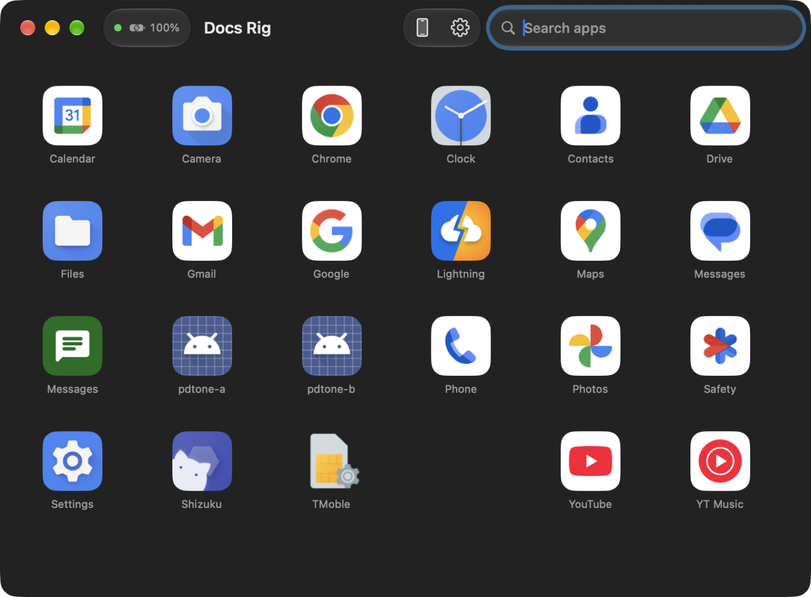

# PocketDeck

PocketDeck runs Android apps in **native Mac windows** over your home network —
one window per Android app, several at once, plus a phone-sized window that
mirrors the phone's screen — **while the phone stays locked in your pocket**.
No cables, no cloud: the phone runs a tiny server inside
[Shizuku](https://shizuku.rikka.app/)'s shell process and streams video over a
single TCP session to the Mac, which drives the apps with real touch, keyboard
and audio in the other direction.

Screen recording is per-app virtual displays on the Android side and
`AVSampleBufferDisplayLayer` on the Mac side, so these are real windows you can
resize into any shape, not screen-capture videos — the app re-lays out to the
window you give it.

| Two apps in Mac windows (Clock in Immersive style, Settings in Framed style — both are the actual Android app) | The Deck: the phone's app grid on the Mac |
|---|---|
|  |  |

| The phone window mirrors the phone's own screen (Back / Home / Recents at the right of the bar) | Pairing, step by step on the phone |
|---|---|
|  |  |

## Features

**Windows and input**

- **One window per app** — pick any app in the Deck (⌘K to search) and it opens
  in its own resizable Mac window; resize into any shape and the app re-lays
  out. Several app windows at once.
- **Phone window** — a mirror of the phone's own screen (status bar, lock
  screen, home, apps), turning with the phone, with Back/Home/Recents buttons.
- **Real input** — typed keys, clicks, drags and scroll; right-click is Android
  Back, middle-click is Home, and a mouse's side **Back** button sends Back. On
  a trackpad, two-finger scroll drags the page like a finger (with fling) and
  pinch/rotate are two fingers around the pointer.
- **Window styles** — a Framed bar (always visible, holds the traffic lights)
  or Immersive (the window *is* the app; a dwell pill brings the lights back).
  Switch with View ▸ Window Style or ⌥⌘F; the choice is remembered per app.
- **Continue on Mac (handoff)** — move the task in the phone's foreground onto
  the Mac (menu bar, app menu, or ⌘⇧C): same app, a new window.

**Phone mode, audio**

- **Audio from the phone to the Mac** — with a window open, the phone's media
  and game audio plays on the Mac with a volume slider and mute in the menu
  bar; media stays silent on the phone's speaker. Capture follows the focused
  window's app where Android allows it and falls back to all-device audio.
  Added latency measured around 80–125 ms on the API 36 emulator
  (docs/design/audio.md).

**Clipboard, links, share, drag and drop, APK install**

- **Clipboard text, both ways** — copy on the phone, paste on the Mac and the
  other way round; clipboard **images** travel both ways too.
- **Links Mac → phone** — Share → **Open on Phone**, Services, or drop a link
  on the Deck; it opens in the Android app that handles it, in a new window.
- **Share phone → Mac** — Android Share → **Send to Mac**: links open in the
  Mac's browser, text lands on the Mac clipboard, images up to 50 MB each are
  saved to `~/Downloads/PocketDeck/` (and the clipboard).
- **Drag and drop** — drop files from Finder on any phone window; the phone
  writes them to `Downloads/PocketDeck/`, scans them and offers the app's Send
  chooser. Up to 200 MiB per file, resumable.
- **Install APKs from the Mac** — drop an `.apk` / `.apks` / `.xapk` bundle on
  the Deck, or use Open With, Services or the menu bar. The Deck shows
  progress and the result.

**Notifications and Now Playing** (opt-in on both sides)

- The phone's notifications appear in macOS Notification Center; clicking one
  opens that app's window.
- Media on the phone shows up in **Now Playing** on the Mac with
  play/pause/next/previous, even while the phone is locked and its screen is
  off.

**The Mac knows the phone**

- **Dock and Launchpad apps** — right-click an app in the Deck → **Add to
  Dock**: a real Mac app bundle named "App (Phone)" with the app's icon, in
  Launchpad, Spotlight and ⌘-Tab. Launching it opens that app's window.
- **Spotlight** — every phone app searches as "App (Phone name)".
- Silently reconnects to the last phone; closes a window by closing the app's
  display, saves bandwidth when a window is hidden or covered, and asks the
  phone for nothing while you're not looking (battery rules in
  docs/ARCHITECTURE.md).

**Security**

- One LAN-only TCP session per phone, one Bonjour advertisement
  (`_pocketdeck._tcp`), and direct connect by address. Pairing shows a
  six-digit code on both screens (numeric comparison) or exchanges a QR code;
  sessions are authenticated with keys created at pairing (docs/PROTOCOL.md).

## Requirements

- **Android 11+** (minSdk 30) with **Shizuku** installed and running.
  Verified against Android 16 (API 36 emulator and a Samsung One UI build).
- **macOS 26 or later.**
- Mac and phone on the same network.

## Install / build from source

No releases yet. Build both sides yourself — the full recipe, including the
pairing walk-through and an emulator rig for phoneless testing, is in
[docs/TRY-IT.md](docs/TRY-IT.md).

## Pairing

1. On the phone: PocketDeck → **Pair new Mac** (first run: **Scan QR code**).
2. On the Mac: **Pair with QR**, or connect by address and compare the
   six-digit code.
3. Tap **Allow** on the phone. Lock it — it never needs to be unlocked.
   Remembers the Mac afterwards.

Every detail: [docs/TRY-IT.md](docs/TRY-IT.md).

## Privacy

- **Nothing leaves your home network.** One TCP session, phone → Mac, over the
  LAN. No accounts, no analytics, no logging anywhere.
- The session is authenticated with per-pairing keys (HMAC auth in
  docs/PROTOCOL.md). The channel is not encrypted yet — see Status.
- **Notifications and Now Playing are off by default on both sides** and need
  a per-phone opt-in (Android's notification-listener consent *and* a switch
  in PocketDeck's UI) before anything is read or shown.
- The phone's screen stays locked. PocketDeck never unlocks it, never
  dismisses the keyguard, and never opens the phone's panel; apps run on a
  virtual display Android treats as unlocked (docs/ARCHITECTURE.md).

## Status

Pre-release. **End-to-end encryption is planned and required before launch** —
mutual TLS with keys pinned at pairing; today's traffic is authenticated but
plaintext on the wire. Details and the rest of the plan: [docs/ROADMAP.md](docs/ROADMAP.md).

## Docs

| | |
|---|---|
| [docs/TRY-IT.md](docs/TRY-IT.md) | setup, first pairing, emulator rig, known limitations |
| [docs/ARCHITECTURE.md](docs/ARCHITECTURE.md) | how the phone and the Mac actually work |
| [docs/PROTOCOL.md](docs/PROTOCOL.md) | the wire protocol (single source of truth) |
| [docs/ROADMAP.md](docs/ROADMAP.md) | status and what is next |
| [docs/UX.md](docs/UX.md) | interface conventions |
| [docs/design/*.md](docs/design) | per-feature design notes (audio, dock, mirror, notify, drops, …) |
| [tools/emulator/](tools/emulator/README.md) | boots the real server on a local emulator |
| [tools/fakephone/](tools/fakephone/README.md) | protocol-complete fake phone for e2e checks |

## License

[PolyForm Noncommercial 1.0.0](LICENSE). You may use, change and share PocketDeck for
personal and other noncommercial purposes; commercial use is not licensed. Third-party
dependencies (SwiftNIO, swift-crypto, …) keep their own licenses.
