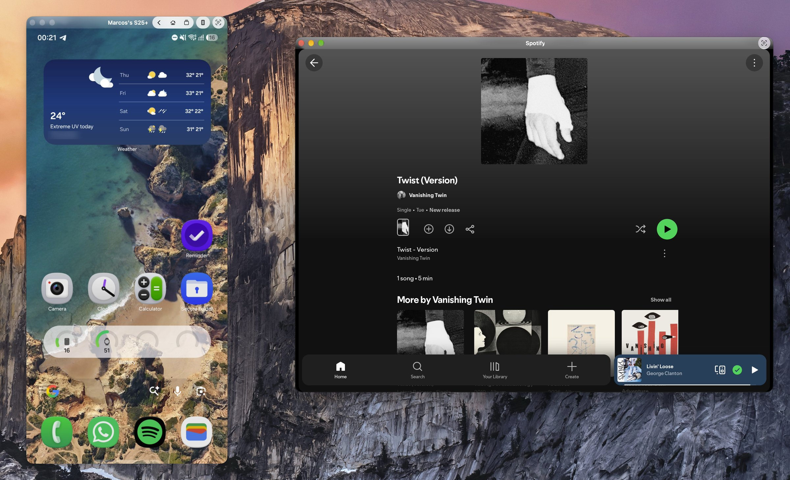
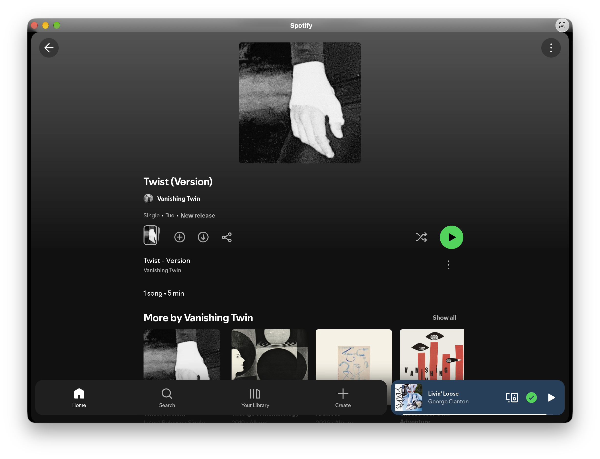
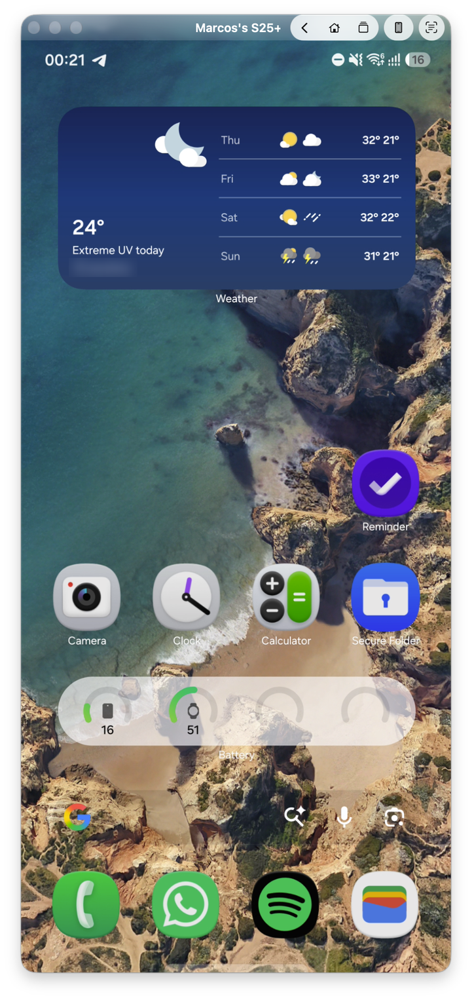

# Contigua

Android apps in native Mac windows, over your home network, with the phone
staying locked.

> **Alpha. There are no downloads yet: build it yourself.** The Mac app has to
> be signed with your own local certificate, or macOS will not let it reach
> your phone over the network. The two-command setup is in
> [docs/TRY-IT.md](docs/TRY-IT.md). Expect rough edges.

| One Android app, one Mac window | The phone's own screen, mirrored |
|---|---|
|  |  |

## Features

| | Feature |
|---|---|
| ✅ | Any phone app in its own resizable Mac window, several at once |
| ✅ | Phone mirror: the phone's own screen, with Back, Home and Recents |
| ✅ | Keyboard, mouse, scroll and trackpad gestures |
| ✅ | Phone audio plays on the Mac |
| ✅ | Clipboard both ways, text and images |
| ✅ | Links and shares between Mac and phone |
| ✅ | Drag files onto a phone window; install APKs from the Mac |
| ✅ | The phone's storage as a location in Finder |
| ✅ | Phone apps in the Dock, Launchpad and Spotlight |
| ✅ | Mac Focus turns on the phone's Do Not Disturb |
| ✅ | Live Text on any window |
| ✅ | AI agents through a local MCP server (off by default) |
| 🧪 | Phone notifications in Notification Center, with reply |
| 🧪 | Phone media in Now Playing |
| 🚧 | Control Center controls |
| 🚧 | Phone as a Mac camera |

✅ works in a source build · 🧪 built, not yet proven on a real phone and Mac ·
🚧 in progress

Always: the phone stays locked, everything stays on your network (mutual TLS
1.3, keys pinned at pairing), no accounts, no analytics. Details and known
limits: [docs/FEATURES.md](docs/FEATURES.md).

## Requirements

- Android 11 or later, with [Shizuku](https://shizuku.rikka.app/) running. No
  root.
- macOS 26 or later, with Xcode.
- The Mac and the phone on the same network.

Tested on Android 16 (an emulator and a Samsung phone) and macOS 26 and later.

## Get started

[docs/TRY-IT.md](docs/TRY-IT.md) walks through building both apps, signing
the Mac app and pairing.

## Docs

| | |
|---|---|
| [docs/TRY-IT.md](docs/TRY-IT.md) | build, sign, pair, troubleshoot |
| [docs/FEATURES.md](docs/FEATURES.md) | every feature and known limit |
| [docs/ARCHITECTURE.md](docs/ARCHITECTURE.md) | how the phone and the Mac work |
| [docs/PROTOCOL.md](docs/PROTOCOL.md) | the wire protocol |
| [docs/ROADMAP.md](docs/ROADMAP.md) | status and what is next |
| [docs/design/mcp.md](docs/design/mcp.md) | connecting an AI agent |
| [SECURITY.md](SECURITY.md) · [docs/THREAT-MODEL.md](docs/THREAT-MODEL.md) | reporting a vulnerability, threat model |
| [docs/CONTRIBUTING.md](docs/CONTRIBUTING.md) | contributing; the code is written with AI agents under human review ([AGENTS.md](AGENTS.md)) |

## Support

Contigua is built by one person. If it is useful to you, you can
[buy me a coffee](https://buymeacoffee.com/marcoslor).

## License

Source-available under the [Functional Source License 1.1, Apache 2.0 future
license](LICENSE) (FSL-1.1-ALv2): use, change and share it for anything except
a competing product or service. Each release becomes Apache 2.0 two years
after it is published. Dependencies keep their own licenses.
